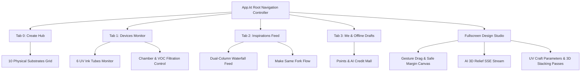

# eufyMake (MakeItReal) Native Mobile Application

A high-fidelity mobile-first client inspired by **eufyMake / AnkerMake v5.0** (`https://makeitreal-beta.eufymake.com/`), built with **Kotlin Multiplatform + Compose Multiplatform**, featuring offline-first mock reactivity, 3D tactile relief craft studio, community feed, hardware telemetry, and points/rewards system.

---

## 📱 Architecture & Platform Fidelity

This project faithfully replicates the official Android experience extracted from the official APK teardown (`com.oceanwing.FDMPrint` v5.0):



---

## 🎨 Core Feature Modules

### 1. 10 Physical Substrates (`Substrate.kt`)
Modeled directly after eufyMake official fixtures:
1. **Scan Object**: Camera contour auto-boundary detection (120×120mm)
2. **Customize**: Freeform dimension setup with print bed constraints (150×150mm)
3. **Art Canvas**: Textured canvas with impasto relief parameters (200×150mm)
4. **Fridge Magnet**: Flexible magnetic vinyl (80×80mm)
5. **Die-cut Sticker**: High-gloss round decal (65×65mm)
6. **Drink Coaster**: Ceramic/cork round coaster (100×100mm)
7. **Member Card**: Standard PVC card with spot varnish (85.6×54mm)
8. **Acrylic Sheet**: Clear/black A5 display plate with heavy relief (210×148mm)
9. **Cylinder Tumbler**: 360° rotary continuous UV printing (230×180mm)
10. **Sphere & Balls**: Spherical fixture for golf balls & holiday ornaments (45×45mm)

### 2. 6-Channel UV Ink Monitor (`DeviceState.kt`, `DevicesScreen.kt`)
- **Cyan (C)**
- **Magenta (M)**
- **Yellow (Y)**
- **Key Black (K)**
- **White (W)**: High-viscosity UV white ink for heightmap stacking passes (0.1–3.0mm)
- **Gloss (G)**: Clear varnish for mirror spot gloss or matte finish

### 3. Dedicated Design Studio (`DesignCanvasScreen.kt`)
- Safe print boundary with dashed margin inset
- Interactive multi-touch & mouse drag canvas
- Real-time layer stack with visibility toggles and tactile relief depth badges
- Bottom 4-Tool Dock:
  - **Upload**: Import photo / vector graphic
  - **Image AI**: Simulated SSE multi-stage generator:
    `Prompt Analysis` -> `Displacement Heightmap (16-bit)` -> `White UV Passes` -> `Gloss Map`
  - **Text**: Typography with dynamic font sizes and ink color selection
  - **Elements**: Geometric badges and frames
- **Undo / Redo Stack**: Reactive command history with instant UI feedback
- **Craft Parameters Sheet**:
  - Print Mode: `Color Only`, `White Only`, `Color + White`, `3D Tactile Relief`
  - Relief Depth Slider: `0.1mm - 3.0mm` (12 to 36 UV ink passes)
  - Gloss Mode: `None`, `Spot Gloss`, `Full Gloss`, `Matte`
  - One-click print dispatcher & community publisher

### 4. Inspirations & Community Feed (`InspirationsScreen.kt`)
- Official Contests & Firmware Announcements carousel
- Category filters (`All`, `Art`, `Home`, `Tech`, `Creative`)
- Dual-column staggered waterfall grid
- **Make Same (Fork)**: Instantly clones another maker's project parameters and opens it in the Studio.

### 5. Points & AI Credits System (`PointsRepository.kt`, `PointsMallDialog.kt`)
- Daily check-in streak reward system
- Task checklist (creating drafts, publishing to feed, AI generations)
- Rewards Mall for UV consumable vouchers and extra AI relief credits.

---

## 🚀 Running the App (Windows / Mobile Viewport Simulation)

Run the included launcher script:
```powershell
.\run-app.ps1
```

Or via Gradle directly:
```powershell
$env:JAVA_HOME = "C:\Users\38788\AppData\Local\mise\installs\java\21.0.2"
& "C:\Users\38788\AppData\Local\mise\installs\gradle\8.10.2\gradle-8.10.2\bin\gradle.bat" :composeApp:run
```

---

## 🧪 Automated Verification Suite

Unit tests in `composeApp/src/commonTest/kotlin/com/eufymake/real/MakeItRealTest.kt` cover:
- Substrates initialization and 360 rotary constraints
- Draft repository auto-save, layer manipulation, and Undo/Redo stack
- Community project like toggling, fork counting, and publishing
- Points checking-in, task progress, and rewards redemption
- Device telemetry, chamber light toggle, air filtration, and 6-ink channels

Run tests via:
```powershell
$env:JAVA_HOME = "C:\Users\38788\AppData\Local\mise\installs\java\21.0.2"
& "C:\Users\38788\AppData\Local\mise\installs\gradle\8.10.2\gradle-8.10.2\bin\gradle.bat" :composeApp:desktopTest
```
Result: **100% Passed (5 tests, 0 failures, 0 errors)**.
